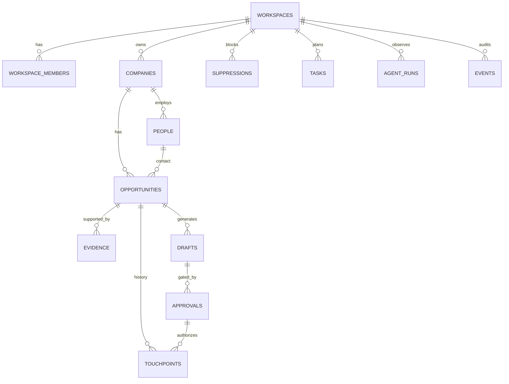

# Supabase CRM Design — Maksutov Growth System

## Why Supabase
The CRM needs relational integrity, RLS, auditability, scheduled triggers and a simple API surface. Supabase gives PostgreSQL as the source of truth, Auth/RLS for the owner dashboard, Edge Functions for server-side actions, and `pg_cron`/`pg_net` for schedules.

## Security boundary
### Browser / owner dashboard
Uses Supabase Auth user JWT and RLS. Never receives the `service_role` key.

### Agent application server
Use a server-held secret / service role or, preferably, a narrow server API/Edge Function that validates requested operations. Do not inject the service role into an OpenAI-hosted sandbox or client browser.

### External-action executor
Separate component. It may send/publish only after:
1. approval status is `approved`;
2. approval is not expired;
3. suppression check passes again;
4. current draft hash exactly equals the approved payload hash.

This executor should expose narrow verbs such as `send_approved_email(approval_id)` rather than generic arbitrary email/send APIs to the drafting agent.

## Entity model

## Core lifecycle
### Direct/studio opportunity
`discovered -> qualified -> drafting -> approval_pending -> approved -> contacted -> replied -> meeting -> proposal -> won|lost`

### Job
Same generic stage machine in MVP; `metadata` may carry application-specific fields. Phase 2 can split a job-specific state model if needed.

## Why evidence is separate
Do not bury provenance in agent-generated notes. Evidence is a first-class table so:
- a draft can cite exactly what triggered personalization;
- stale evidence can be detected;
- facts and inference remain distinguishable;
- scoring can be audited later.

## Approval integrity
A draft automatically receives SHA-256 `payload_hash` over type/channel/subject/body. An approval stores that hash plus a payload snapshot. Changing the draft invalidates pending/approved approvals and increments draft version.

## Suppression
Suppression supports email, person, company and domain. It is checked:
- before creating a send-ready draft;
- before creating approval;
- immediately before external send.

The final external executor must call `is_suppressed(...)` even if prior checks passed.

## RLS
Every user-facing table has `workspace_id` and RLS. Authenticated users can only see member workspaces. Operators may modify operational records; destructive deletion is owner/admin only; `events` is append-only for normal authenticated users.

For an MVP with one owner this may look verbose, but it prevents re-architecting the database when an assistant/operator is added later.

## Scheduling
Recommended split:
- `pg_cron` schedules a small Edge Function / application endpoint.
- endpoint creates a task/run and invokes the agent runtime.
- runtime writes results back to CRM.
- no scheduled job directly sends external messages.

Store scheduler credentials in Supabase Vault, not migration files.

## Recommended Edge Functions / API endpoints
- `run-agent` — validates requested agent name + workspace, starts runtime.
- `approval-action` — approve/reject A2/A3 request as authenticated owner.
- `execute-approved-action` — server-only; revalidates hash/suppression and performs narrow side effect.
- `ingest-webhook` — receives delivery/reply/provider events and writes touchpoints/events.

## Indexing
MVP indexes cover:
- domain/email dedupe
- pipeline by stage/next action
- score ranking
- approval queue
- recent touchpoints
- agent run history
- event analytics

Add indexes only after real query plans show need; avoid speculative index sprawl.

## Backups and retention
- Use Supabase project backups appropriate to plan.
- Do not store secrets in CRM rows/logs.
- Store minimal contact data required for business outreach.
- Keep suppression records even if a lead is archived so opt-outs are not forgotten.

## Migration order
1. `001_core.sql`
2. `002_functions_triggers.sql`
3. `003_rls.sql`
4. `004_views.sql`
5. optionally run seed after Auth user exists.

## First acceptance test
1. Create Auth user A and workspace.
2. Create Auth user B.
3. As A, insert company/opportunity.
4. As B, verify zero visibility.
5. Create draft as A; note hash.
6. Create pending approval with the same hash.
7. Approve with `approve_action`.
8. Modify draft body; verify approval becomes `invalidated` and draft version increments.
9. Add suppression; verify `is_suppressed` returns true.
10. Verify `v_approval_queue` obeys RLS.
